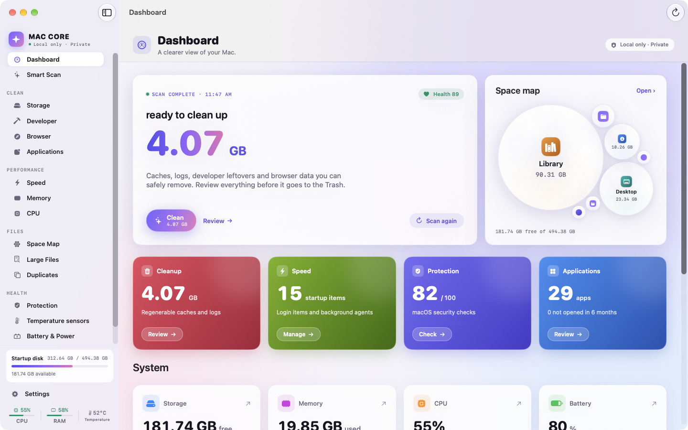
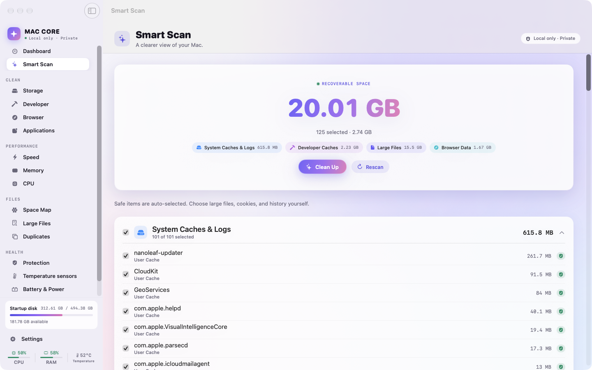
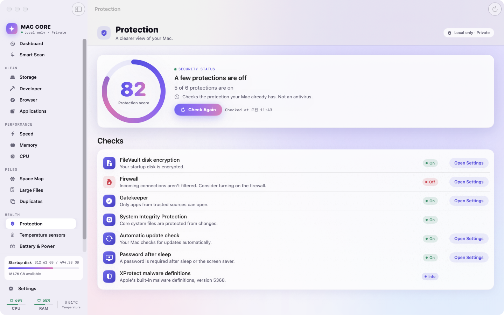

# MAC CORE

> Clean Mac. Clear mind.

MAC CORE is a native macOS system monitor and cleaner built with SwiftUI and Apple frameworks only. This repository contains the **full direct-distribution edition**: every feature, including those the Mac App Store sandbox does not allow.

**Download:** [furyus.dev/products/mac-core/download](https://furyus.dev/products/mac-core/download) · [GitHub Releases](../../releases/latest). Builds are signed with Developer ID and notarized by Apple.



## Features

| Area | What it does |
|---|---|
| Home | Reclaimable space, Space Map preview and four at-a-glance cards: Cleanup, Speed, Protection, Applications |
| Smart Scan | Reviews system, developer, large-file and browser data in one pass; only safe items are pre-selected |
| Space Map | Bubble map of your home folder; drill down, reveal in Finder, see what is worth cleaning |
| Duplicates | Finds identical files by content (size, quick hash, then SHA-256) and keeps one copy in every group |
| Speed | Login items and background agents; switch your own agents off or on with `launchctl` |
| Protection | FileVault, firewall, Gatekeeper, SIP, automatic updates, screen lock and XProtect status. Not an antivirus |
| Storage | System Data analysis, caches, logs, developer caches, Trash and large downloads |
| Memory / CPU | Mach/sysctl readings, process table, confirmed termination of your own processes |
| Temperature | Sensor names with current and session min/max, search, sort, recent history |
| Battery & power | Voltage, current, battery watts, design/full capacity, cycles, adapter rating, live input and system load |
| Network | Per-interface rates and 64-bit totals, primary interface, charts |
| Developer | Xcode DerivedData/Archives, Simulator, SwiftPM, Homebrew, Gradle caches |
| Applications | Size and last-opened date, unused-app filter, uninstall together with leftovers matched by bundle identifier |
| Browsers | Supported caches, cookies, history and sessions for Safari, Chrome, Edge and Firefox |
| Menu bar | Up to four of nine metrics, with order, format, units, individual sensors and refresh rate |

Ten interface languages (English, Korean, Japanese, Simplified and Traditional Chinese, Spanish, French, German, Brazilian Portuguese, Arabic with RTL). Light and dark appearance.




## Safety

- Cleans only known cache, log and leftover locations. System locations and the data of running apps are protected.
- Items move to Trash by default. Permanent deletion requires Advanced Mode and a second confirmation.
- No account, analytics, advertising or network requests. Everything is processed on your Mac.
- No privileged helper, kernel extension, fan control or charge control.

Temperature and some power readings use IOKit/HID interfaces that are not public API contracts. Sensors vary by Mac and macOS version; unavailable values show as `—` and are never guessed.

## Requirements

macOS 14 or later on Apple silicon or Intel. For complete cleanup results, grant Full Disk Access in System Settings → Privacy & Security. The app works without it, with fewer locations.

## App Store edition

A separate, sandboxed MAC CORE edition is distributed through the Mac App Store. It uses public APIs only and cleans caches, logs and Xcode data in folders the user approves. Install only one edition at a time; both use the same bundle identifier.

## Building

```bash
xcodebuild -project MacCoreCleaner.xcodeproj -scheme MacCoreCleaner -configuration Release -destination 'generic/platform=macOS' build
```

```bash
xcodebuild test -project MacCoreCleaner.xcodeproj -scheme MacCoreCleaner -destination 'platform=macOS'
```

`Scripts/release.sh` creates a Developer ID signed, notarized release archive.

## Support

[furyus.dev/products/mac-core/support](https://furyus.dev/products/mac-core/support) · admin@furyus.dev

© 2026 FURYUS. All rights reserved.
